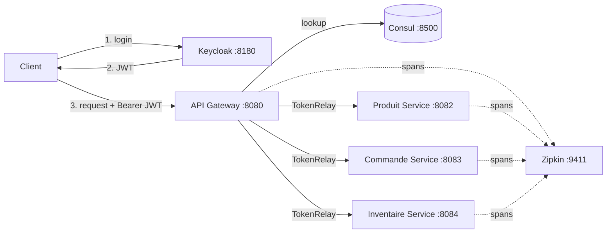
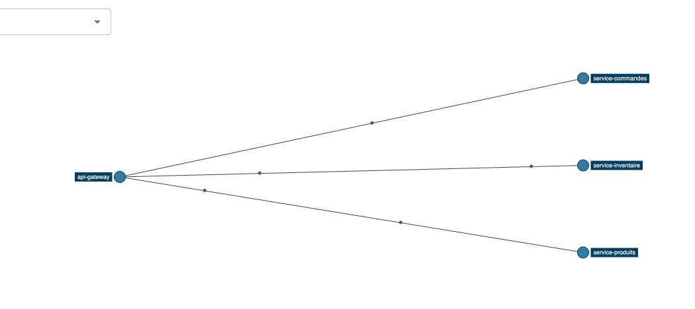

# Secure Microservice Platform

A secured microservice architecture built with **Spring Boot**, **Spring Cloud Gateway**, **Keycloak**, **Consul** and **Zipkin**.

Every request is authenticated with OAuth2 / JWT, authorized by role, routed through a single gateway, discovered dynamically, protected by circuit breakers and traced end to end.

> Academic project, Institut Polytechnique de Saint-Louis (IPSL), Senegal, 2026.

---

## Architecture



| Component | Port | Role |
|---|---:|---|
| API Gateway | 8080 | Single entry point, JWT validation, routing, circuit breakers, user registration |
| Produit Service | 8082 | Product catalog |
| Commande Service | 8083 | Orders |
| Inventaire Service | 8084 | Stock, with admin-only updates |
| Keycloak | 8180 | Identity provider (OAuth2 / OpenID Connect) |
| Consul | 8500 | Service discovery and health checks |
| Zipkin | 9411 | Distributed tracing |

## Tech stack

- Java 21, Spring Boot 3.2, Spring Cloud 2023.0
- Spring Security OAuth2 Resource Server (JWT)
- Spring Cloud Gateway (reactive) with `TokenRelay`
- Keycloak 26 (realm roles, service accounts, Admin REST API)
- Consul service discovery with Spring Cloud LoadBalancer (`lb://`)
- Resilience4j circuit breakers
- Micrometer Tracing (Brave) and Zipkin

## Security design

**Defense in depth.** The JWT is validated twice: once at the gateway, and again by each service. If a service is reached directly, bypassing the gateway, it still rejects unauthenticated or unauthorized requests.

**Role-based access control.** Keycloak realm roles (`ROLE_USER`, `ROLE_ADMIN`) are mapped to Spring Security authorities by a custom `JwtRoleConverter`.

| Endpoint | Rule |
|---|---|
| `GET /produits/**`, `GET /commandes/**`, `GET /inventaire/**` | `ROLE_USER` |
| `PUT /inventaire/{id}` | `ROLE_ADMIN` (`@PreAuthorize`) |
| `POST /api/auth/register` | public |

**Self-service registration.** `POST /api/auth/register` creates users in Keycloak through the Admin REST API. The gateway authenticates with a dedicated `registration-service` client (client credentials flow) whose service account only holds the roles it needs: `manage-users`, `view-users`, `view-realm`. New users automatically receive `ROLE_USER`.

**Secret management.** No client secret lives in the code. Secrets are stored in `api-gateway/.env` (git-ignored) and loaded by Spring Boot at startup with `spring.config.import: optional:file:.env[.properties]`. Secrets that were exposed in an earlier commit have been rotated in Keycloak.

## Security test results

| Scenario | Request | Result |
|---|---|---|
| No token | `GET /api/produits` | **401** |
| Invalid or expired token | `GET /api/produits` | **401** |
| Valid token (user) | `GET /api/produits` | **200** |
| User updates stock | `PUT /api/inventaire/1` as `ROLE_USER` | **403** |
| Admin updates stock | `PUT /api/inventaire/1` as `ROLE_ADMIN` | **200** |
| Registration | `POST /api/auth/register` | **201**, then the new user logs in (**200**) |
| Product service down | `GET /api/produits` | **503** fallback, other routes stay **200** |
| Product service back up | `GET /api/produits` | **200**, circuit closes on its own |

## Resilience

Each gateway route is wrapped in a Resilience4j circuit breaker (window of 5 calls, 50% failure threshold, 10 s open state). When a service goes down, the gateway returns a clean fallback instead of timing out:

```json
{"erreur": "Service Produits indisponible", "conseil": "Reessayez dans quelques secondes"}
```

The failure stays isolated: the other services keep answering normally.

## Observability

Sampling is set to 100% for development, so every request gets a trace ID created at the gateway and propagated to the downstream service. Zipkin rebuilds the service map from real traffic:



## Running locally

### Prerequisites

- Java 21
- Docker

### 1. Start the infrastructure

First run, from the project root:

```bash
docker run -d --name keycloak -p 8180:8080 -e KC_BOOTSTRAP_ADMIN_USERNAME=admin -e KC_BOOTSTRAP_ADMIN_PASSWORD=admin -v "$PWD/keycloak:/opt/keycloak/data/import" quay.io/keycloak/keycloak:26.7.4 start-dev --import-realm
docker run -d --name consul -p 8500:8500 hashicorp/consul agent -dev -client=0.0.0.0
docker run -d --name zipkin -p 9411:9411 openzipkin/zipkin
```

Next runs:

```bash
docker start keycloak consul zipkin
```

Keycloak imports `keycloak/realm-export.json` on first start. The `tp-microservices` realm comes fully configured:

- realm roles `ROLE_USER` and `ROLE_ADMIN`
- client `gateway-client` (confidential, direct access grants)
- client `registration-service` (service account with `manage-users`, `view-users`, `view-realm`)
- test users `alice` / `alice123` (`ROLE_USER`) and `bob` / `bob123` (`ROLE_USER`, `ROLE_ADMIN`)

The export contains no client secrets and no signing keys. Keycloak generates fresh ones on import.

### 2. Add the secrets

Copy the template:

```bash
cp api-gateway/.env.example api-gateway/.env
```

Then, in the admin console (`http://localhost:8180`, admin / admin), open **Clients → gateway-client → Credentials** and **Clients → registration-service → Credentials**, and paste both secrets into `api-gateway/.env`.

### 3. Start the services

```bash
./start-services.sh
```

After about a minute, the four services appear in Consul at `http://localhost:8500`.

### 4. Try it

```bash
TOKEN=$(./get-token.sh alice alice123)
curl -i http://localhost:8080/api/produits -H "Authorization: Bearer $TOKEN"
```

```bash
curl -i -X POST http://localhost:8080/api/auth/register -H "Content-Type: application/json" -d '{"username":"david","email":"david@example.com","password":"david123","firstName":"David","lastName":"User"}'
```

Access tokens expire after 5 minutes by default. Run `get-token.sh` again to get a fresh one.

## Project structure

```text
keycloak/             Realm export (roles, clients, test users), imported at startup
api-gateway/          Gateway, security config, fallbacks, registration (auth/)
produit-service/      Products
commande-service/     Orders
service-inventaire/   Inventory, admin-only updates
get-token.sh          Fetches a JWT for a user (reads secrets from .env)
start-services.sh     Starts the four Spring Boot apps
Rapport-du-Projet.html  Full project report (French)
```

## Author

**Aliou Ba**, computer and telecommunications engineering student at IPSL.
GitHub: [@aliou27](https://github.com/aliou27)
